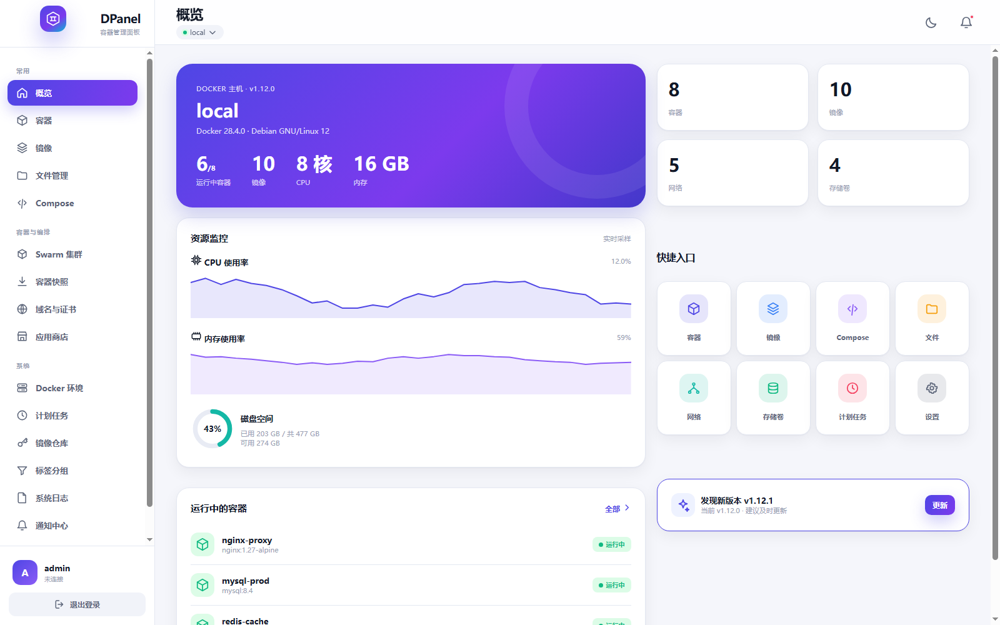
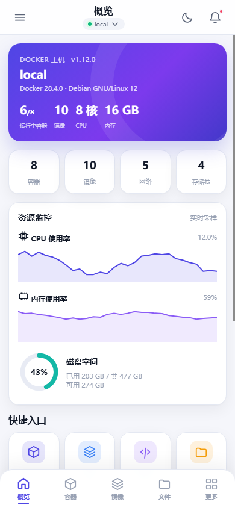

# DPanel Aurora

基于开源容器管理面板 [DPanel](https://github.com/donknap/dpanel) 的深度定制版本 —— 全新重写的响应式前端 UI，桌面端是完整的仪表盘布局，手机端自动切换为底部导航的 App 式交互，一套代码同时适配桌面 / 平板 / 手机。

后端完全沿用 DPanel 原版 Go 服务，功能与 API 保持兼容；前端为纯原生 HTML/CSS/JS 实现（零框架、零构建依赖），已内嵌进镜像的静态资源。





## ✨ 特性

- **响应式布局**
  - 桌面（≥1024px）：左侧常驻导航栏（16 个功能入口）+ 顶栏 + 多列卡片仪表盘，概览页左右分栏
  - 平板：全屏单栏布局
  - 手机：底部 5 项 Tab 导航，单栏卡片流，适配刘海屏安全区
- **明暗双主题**，跟随偏好自由切换
- **登录页**：桌面品牌渐变双栏，手机单栏卡片；首次登录自动完成创始人初始化
- **19 个功能页面**：概览、容器、镜像、网络、卷、Compose、文件管理、Swarm、快照、域名证书、应用商店、Docker 环境、计划任务、镜像仓库、标签分组、系统日志、通知中心、设置等
- **演示模式**：无需账号即可预览，URL 加 `?demo=1`
- 镜像内集成 `docker-cli` / `docker-cli-compose` / `buildx`，可直接在面板内管理宿主机容器

## 🚀 快速部署

### 方式一：Docker Compose（推荐）

```bash
curl -O https://raw.githubusercontent.com/opersdev/dpanel-aurora/master/docker-compose.yml
docker compose up -d
```

### 方式二：docker run

```bash
docker run -d \
  --name dpanel-aurora \
  --restart unless-stopped \
  -p 8808:8080 \
  -v /var/run/docker.sock:/var/run/docker.sock \
  -v dpanel-data:/dpanel \
  ghcr.io/opersdev/dpanel-aurora:latest
```

> 需要挂载 `/var/run/docker.sock`，面板通过它管理宿主机上的容器。

启动后访问：

- 面板：<http://localhost:8808/dpanel/ui>
- 演示模式：<http://localhost:8808/dpanel/ui?demo=1>

### 首次使用

新部署没有预置账号。打开页面后直接输入你想用的用户名和密码，前端会自动调用创始人初始化接口完成账号创建，之后正常登录即可。

### 端口与目录

| 项目 | 说明 |
| --- | --- |
| `8808:8080` | 左侧为宿主机端口，可自行修改 |
| `/dpanel` | 数据卷：SQLite 数据库、ACME 证书、Compose 项目、构建缓存等持久化数据 |
| `/var/run/docker.sock` | Docker 套接字，面板管理容器的通道 |

## 🐳 镜像说明

- 镜像发布在 GHCR：`ghcr.io/opersdev/dpanel-aurora`
- 每次推送到 `master` 自动构建 `latest`；推送 `v*` 标签会生成对应的版本 tag（如 `v1.0.0`）
- 当前构建架构：`linux/amd64`
- 构建方式：多阶段构建，第一阶段拉取上游 donknap/dpanel 源码并注入本仓库前端后编译（lite 模式），第二阶段基于 Alpine 3.21 打包
- 后端版本锁定：`docker build --build-arg DPANEL_REF=<tag或分支>`，默认跟随上游 master

## 🛠️ 本地构建镜像

```bash
git clone https://github.com/opersdev/dpanel-aurora.git
cd dpanel-aurora
docker build -f docker/Dockerfile.web -t dpanel-aurora:local .
```

## 🎨 修改前端 UI

- 前端源码在 [`ui-source/`](ui-source/) 目录：`index.html` + `css/` + `js/`，纯原生实现，改完无需任何构建步骤
- 同步到后端静态资源：

```bash
bash sync-ui.sh   # 将 ui-source 同步进 asset/static，随镜像一起打包
```

> `ui-source` 中的页面通过相对路径 `./css/...`、`./js/...` 引用资源，可直接用任意静态服务器本地预览。

## 📦 目录结构

```
├── asset/static/        # 内嵌到后端的前端产物（由 ui-source 同步）
├── ui-source/           # 前端源码（HTML/CSS/JS，可直接修改）
├── app/ common/ database/ ...  # DPanel 原版 Go 后端源码
├── docker/
│   ├── Dockerfile.web   # 本仓库使用的镜像构建文件
│   └── task/            # 容器入口脚本
├── docs/                # 截图
├── android-app/         # 安卓 App 工程（WebView 壳，复用 ui-source）
├── ios/                 # iOS App 工程（SwiftUI + WKWebView 壳，复用 ui-source）
├── docker/
│   └── Dockerfile.web   # 镜像构建（后端构建时从上游拉取）
├── docker-compose.yml   # 一键部署
├── sync-ui.sh           # 前端源码 → 后端静态资源同步脚本
└── android-app/sync-assets.sh  # 前端源码 → 安卓 assets 同步脚本
```

> 本仓库**只维护前端与移动端**：Go 后端不在仓库内，构建镜像时自动从上游 [donknap/dpanel](https://github.com/donknap/dpanel) 拉取，与官方保持同步。

## 📱 移动端 App（Android / iOS）

同一套 `ui-source/` 前端，分别打包成安卓 APK 与 iOS IPA：

### Android

- 工程：[`android-app/`](android-app/)（WebView 壳，界面资源由 `sync-assets.sh` 从 `ui-source/` 同步进 assets）
- 推送到 `master` 时 GitHub Actions 自动构建**未签名 APK**（`.github/workflows/build-android-apk.yml`），在 Actions 运行页下载 artifact `DPanel-unsigned-apk`
- 本地构建：`bash android-app/sync-assets.sh && cd android-app && ./gradlew assembleRelease`

### iOS

- 工程：[`ios/`](ios/)（SwiftUI + WKWebView，XcodeGen 描述，详细说明见 [ios/README.md](ios/README.md)）
- 推送到 `master` 时自动产出**未签名 IPA**（artifact `DPanel-unsigned-ipa`）
- 未签名 IPA 需重签后安装：Windows 用 [Sideloadly](https://sideloadly.io/) + Apple ID（免费证书 7 天续签），或有 Mac/开发者账号直接签名
- 零成本替代：iPhone Safari 打开面板地址 → 分享 → 添加到主屏幕（PWA）

> 改前端 UI 只需改 `ui-source/`：Web/镜像/安卓 APK 都从它同步，一处修改三端生效。

## 🙏 致谢与许可

- 后端与原始项目：[donknap/dpanel](https://github.com/donknap/dpanel)，遵循其原版 [LICENSE](LICENSE)
- 前端 UI 为本仓库原创重写
